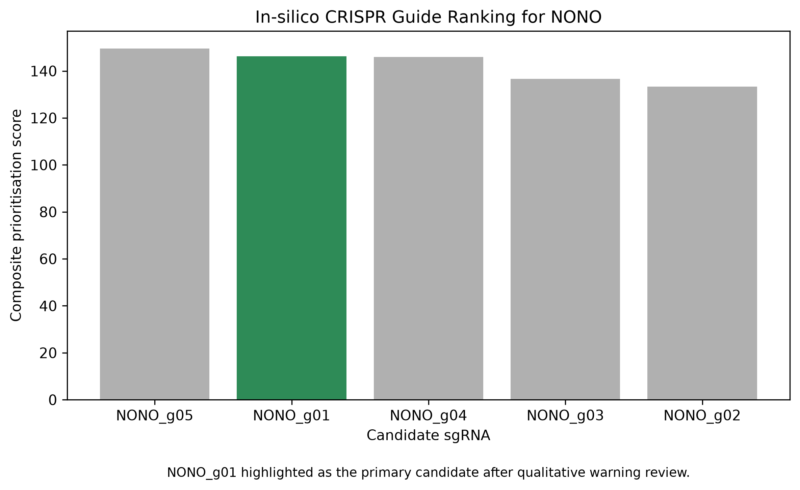

# In-silico CRISPR/Cas9 Guide Design for NONO

## Overview

This repository documents an **in-silico CRISPR/Cas9 guide-design and prioritisation workflow** for the human **NONO** gene.

NONO was selected from candidate genes evaluated during my master’s thesis-related work on intellectual disability. The goal of this project was to convert a candidate-gene finding into a transparent, reproducible **pre-experimental functional-genomics design**.

The project includes:

- Retrieval of a genomic DNA target region from the human GRCh38/hg38 assembly
- Candidate SpCas9 sgRNA generation using CRISPOR
- Review of predicted activity, specificity, GC content, warnings, and visible off-target genomic context
- Python-based candidate-guide ranking
- A documented qualitative guide-selection decision
- A proposed PCR/Sanger sequencing validation strategy

> **Important:** This is an in-silico design project. No CRISPR editing, cell culture, transfection, sequencing, or molecular validation was performed.

---

## Research question

Can a reproducible computational workflow identify and prioritise candidate SpCas9 sgRNAs for a proposed loss-of-function study of the human **NONO** gene?

---

## Biological rationale

NONO encodes a DNA- and RNA-binding protein involved in transcriptional regulation, RNA processing, and paraspeckle biology. It was selected because it was among candidate genes identified in thesis-related work focused on intellectual disability.

A CRISPR/Cas9 loss-of-function design provides a potential framework for future functional studies investigating the molecular consequences of NONO disruption in an appropriate model system.

This project does not claim that NONO disruption causes a phenotype. It provides a computational design framework that would require supervised wet-lab validation.

---

## Workflow

### 1. Genomic target-region retrieval

A genomic DNA region surrounding a candidate NONO target region was retrieved from the UCSC Genome Browser using the human **GRCh38/hg38** assembly.

| Parameter | Value |
|---|---|
| Gene | `NONO` |
| Species | *Homo sapiens* |
| Genome assembly | GRCh38 / hg38 |
| Core genomic region | `chrX:71,283,639-71,283,727` |
| Added flanking sequence | 200 bp upstream and 200 bp downstream |
| Approximate input sequence length | 489 bp |
| Sequence file | `data/raw/NONO_target_region_hg38.fasta` |

### 2. Candidate guide generation

Candidate guide RNAs were generated using CRISPOR.

| Parameter | Setting |
|---|---|
| Tool | CRISPOR |
| Genome | Human hg38 / GRCh38 |
| Nuclease | SpCas9 |
| PAM | NGG |
| Input | Approximately 489 bp NONO-region genomic DNA sequence |

An initial attempt using a full NONO mRNA sequence was not suitable for genome-based analysis because spliced mRNA is not represented as a single continuous genomic sequence. The workflow was revised to use a UCSC-derived genomic DNA target region.

### 3. Candidate prioritisation

Candidate guides were reviewed using:

- Predicted activity/on-target score
- Predicted specificity score
- GC content, with values closer to 50% favoured
- Number of predicted off-targets
- CRISPOR warning status
- Visible predicted off-target genomic context
- Presence of predicted exonic off-target annotations

Guides flagged as **“Inefficient”**, guides with concerning visible predicted exonic off-targets, and guides with promoter-compatibility warnings were deprioritised.

### 4. Reproducible ranking

The Python script `scripts/rank_guides.py` reads candidate-guide data from:

```text
data/raw/candidate_guides.csv
```

It creates:

```text
results/guide_ranking.csv
```

The composite prioritisation score is calculated as:

\[
\text{Composite score} =
\text{On-target score}
+
\text{Specificity score}
-
(0.1 \times \text{Predicted off-target count})
-
\text{GC penalty}
\]

where:

\[
\text{GC penalty} =
\frac{|\text{GC percentage} - 50|}{50}
\]

This score is a transparent prioritisation aid. It is not a validated predictor of experimental editing performance.

---

## Candidate-guide ranking



The candidate guides were ranked by the composite prioritisation score.

| Guide ID | Spacer sequence | PAM | Direction | Composite score | Selection status |
|---|---|---|---|---:|---|
| `NONO_g01` | `CAATCAAGGTTTAGCTCCCG` | AGG | Reverse | 146.3 | Primary computational candidate |
| `NONO_g04` | `GGAAACGAGACGACGGAGCT` | CGG | Reverse | 146.0 | Secondary candidate |
| `NONO_g03` | `CGGAAAAATGATTCCGCCTC` | GGG | Forward | 136.7 | Secondary candidate |
| `NONO_g02` | `CTCGGGAGCTAAACCTTGAT` | TGG | Forward | 133.4 | Secondary candidate |
| `NONO_g05` | `GCGCGCTCTTTTCTCGGGAC` | GGG | Forward | 149.5 | Backup only |

### Primary-candidate selection

`NONO_g05` obtained the highest **unadjusted** composite score. However, CRISPOR flagged it as **“Not with U6/U3.”** Because the first scoring formula did not include a warning penalty, it was retained only as a backup candidate.

`NONO_g01` was selected as the primary computational candidate because it:

- Had no visible CRISPOR efficiency or promoter-compatibility warning
- Had balanced GC content of 50%
- Had favourable predicted activity and specificity values
- Had no visible predicted exonic off-target annotation in the reviewed CRISPOR output
- Achieved one of the highest composite prioritisation scores among non-warning candidates

> The primary candidate designation is a computational prioritisation decision. It does not establish editing efficiency, specificity, safety, or biological effect.

---

## Results

This project produced:

- A reproducible hg38 genomic target-region sequence for the NONO locus
- Five computationally shortlisted SpCas9 candidate guides
- A ranked candidate-guide table generated with Python and pandas
- A visual ranking figure generated with Python and matplotlib
- A transparent distinction between numerical ranking and qualitative warning/off-target review
- A primary candidate (`NONO_g01`), three secondary candidates, and one backup candidate

The output is useful as a **pre-experimental decision-support resource**. It can help guide later supervised laboratory testing by prioritising several candidate sgRNAs rather than selecting a single guide solely from one predicted score.

---

## Proposed experimental validation

No wet-lab work was performed. In a future supervised laboratory study, the following steps would be required:

1. Re-check selected guide sequences against the current reference genome and guide-design resources.
2. Select an appropriate cellular model and delivery method.
3. Include non-targeting, mock-treated, and independent-guide controls.
4. Introduce SpCas9 and candidate guide RNAs.
5. Amplify the target locus using PCR.
6. Confirm on-target indels using Sanger sequencing or targeted amplicon sequencing.
7. Measure editing efficiency using a suitable sequencing-analysis method.
8. Evaluate priority predicted off-target sites experimentally.
9. Assess NONO transcript and protein abundance.
10. Investigate downstream molecular and phenotype-related effects only after confirming editing.

---

## Repository structure

```text
NONO-in-silico-CRISPR/
├── README.md
├── requirements.txt
├── .gitignore
├── data/
│   └── raw/
│       ├── NONO_target_region_hg38.fasta
│       └── candidate_guides.csv
├── docs/
│   ├── biological_rationale.md
│   ├── crispr_design_protocol.md
│   ├── off_target_assessment.md
│   ├── validation_plan.md
│   └── limitations.md
├── figures/
│   ├── guide_ranking.png
│   └── README.md
├── results/
│   ├── guide_ranking.csv
│   └── guide_selection_summary.csv
└── scripts/
    ├── rank_guides.py
    └── plot_guide_ranking.py
```

---

## Reproduce the analysis

### 1. Clone the repository

```bash
git clone [https://github.com/YOUR-USERNAME/NONO-in-silico-CRISPR.git](https://github.com/YOUR-USERNAME/NONO-in-silico-CRISPR.git)
cd NONO-in-silico-CRISPR
```

### 2. Create and activate a virtual environment

#### Windows PowerShell

```powershell
python -m venv .venv
.venv\Scripts\Activate
```

#### macOS/Linux

```bash
python -m venv .venv
source .venv/bin/activate
```

### 3. Install dependencies

```bash
pip install pandas matplotlib
```

### 4. Run the ranking analysis

```bash
python scripts/rank_guides.py
```

### 5. Generate the plot

```bash
python scripts/plot_guide_ranking.py
```

---

## Tools and resources

- **UCSC Genome Browser** — genomic target-region retrieval
- **CRISPOR** — candidate sgRNA generation and predicted off-target review
- **Python** — reproducible data processing
- **pandas** — CSV processing and guide ranking
- **matplotlib** — visualisation
- **Git and GitHub** — version control and project documentation

---

## Limitations

- This is an in-silico project, not a wet-lab CRISPR/Cas9 experiment.
- Candidate activity and specificity values are model-based predictions.
- Predicted off-target analyses do not replace experimental off-target assessment.
- The selected target region was treated as a candidate NONO genomic target region; formal exon identity should be verified before experimental use.
- The composite score is a custom prioritisation framework, not a validated guide-performance model.
- Actual guide performance can differ by cell type, chromatin accessibility, delivery method, nuclease expression, and DNA-repair pathways.
- No claim is made that any candidate guide edits NONO efficiently or safely.

---

## Author

Kaushik Kumar Baidya  
Life-science postgraduate | Genomics and functional-genomics portfolio project

---

## Suggested repository topics

```text
crispr-cas9
bioinformatics
functional-genomics
genomics
nono
intellectual-disability
python
molecular-biology
in-silico
```

---

## Citation and attribution

If this repository is used or adapted, please cite the relevant external resources used for sequence retrieval and guide design:

- UCSC Genome Browser
- CRISPOR
- Human GRCh38/hg38 reference genome resources

The guide sequences and scores in this repository are computational outputs generated for educational and portfolio purposes and must be independently verified before any experimental use.